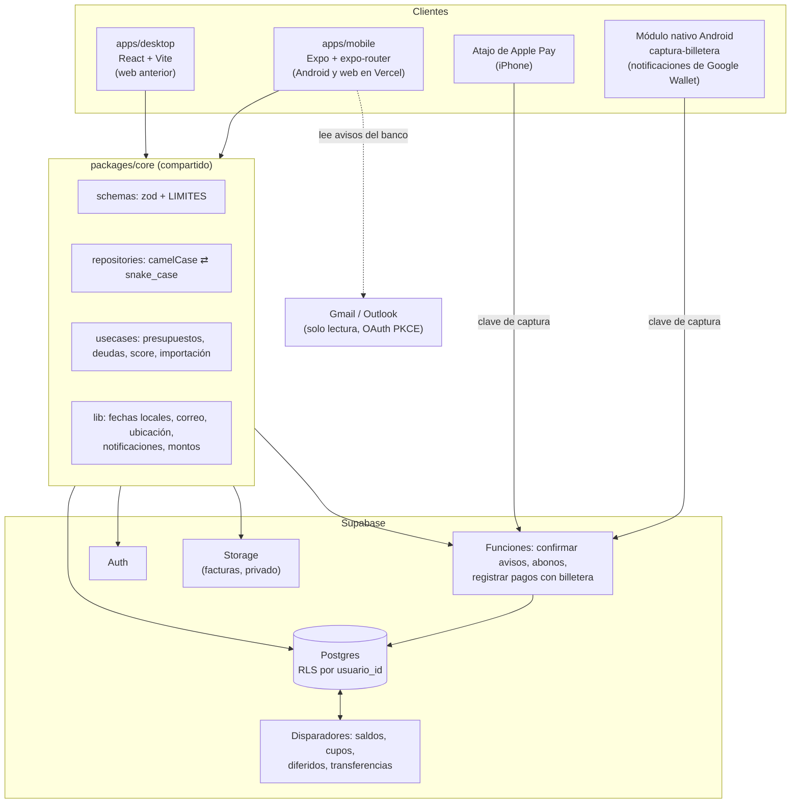

# FinTrack (gastos-app)

App de finanzas personales para Ecuador. Registra gastos, ingresos, tarjetas de crédito, cuentas, transferencias entre tus cuentas, deudas, recordatorios, categorías y presupuestos. Además, detecta pagos solos: los de Google Wallet y Apple Pay, y los avisos del banco que llegan al correo.

Bancos con logo y catálogo: Banco Guayaquil, Pichincha, Produbanco, Diners Club, Banco del Pacífico y Banco del Austro. Casas comerciales: Comandato, Artefacta, Marcimex, La Ganga, Japón, De Prati y Créditos Económicos.

**El producto principal es la app de teléfono** (`apps/mobile`, Expo). El mismo código se publica como versión web en Vercel. `apps/desktop` es una versión web anterior (React + Vite) que sirvió de referencia y hoy va detrás del teléfono. Las tres usan la misma lógica (`packages/core`) y el mismo backend (Supabase).

> **Estado (18-oct-2026)**
> - Teléfono: versión **1.4.0**. Falta compilar el APK y probarlo en un teléfono real.
> - Base de Supabase web: **al día**, con 36 migraciones del repositorio más `cupo_en_lote` (ver [Base de datos](#base-de-datos)).
> - Pruebas en verde: **328** de base de datos, **218** de lógica, **18** del teléfono y **3** de la web de escritorio. Sin errores de tipos en ninguna parte.
> - Auditoría completa: [`docs/auditoria-app-2026-10-18.md`](docs/auditoria-app-2026-10-18.md). Lo que falta para publicar: [Pendientes](#pendientes-y-riesgos).

## Contenido

1. [Qué hace](#qué-hace)
2. [Ejemplos de uso](#ejemplos-de-uso)
3. [Arquitectura](#arquitectura)
4. [Stack](#stack)
5. [Estructura del repositorio](#estructura-del-repositorio)
6. [Primeros pasos](#primeros-pasos)
7. [Base de datos](#base-de-datos)
8. [Seguridad](#seguridad)
9. [Privacidad y documentos legales](#privacidad-y-documentos-legales)
10. [Pagos detectados solos](#pagos-detectados-solos)
11. [Notificaciones](#notificaciones)
12. [Pruebas y verificación](#pruebas-y-verificación)
13. [App instalable y actualizaciones](#app-instalable-y-actualizaciones)
14. [Pendientes y riesgos](#pendientes-y-riesgos)
15. [Reglas para contribuir](#reglas-para-contribuir)
16. [Documentos](#documentos)

## Qué hace

| Módulo | Teléfono y web de Vercel (`apps/mobile`) | Web de escritorio (`apps/desktop`) |
|---|---|---|
| Resumen | Balance del mes, últimos 7 días, salud financiera, recomendaciones, actividad reciente y dónde gastas más | Balance, gráfico de 7 días, salud financiera, recomendaciones y actividad |
| Gastos | Crear, editar y eliminar; vista por semana (abre la de hoy); diferidos de 3 a 24 meses con interés; «pagado con» Apple Pay o Google Wallet; ubicación opcional; detalle con mapa | Alta completa, factura adjunta, OCR de recibos, edición en la tabla |
| Ingresos | Crear, editar, eliminar y gráfico | Alta y gráfico por semana o mes |
| Tarjetas | Catálogo con imagen real, cupo, fecha de corte y de pago, «Pagar tarjeta» desde una cuenta, importar estado de cuenta, últimos dígitos | Catálogo, cupo, estado de cuenta y pago |
| Cuentas | Ahorro, débito y efectivo; historial con gastos, ingresos, pagos, abonos y transferencias; importar estado de cuenta; últimos dígitos | Logo del banco, ocultar saldo, acciones rápidas |
| Transferencias | Entre cuentas propias: no cuentan como gasto ni ingreso. Las del correo se juntan solas | — (pendiente) |
| Deudas | Manuales y automáticas (las crea un diferido); abono con cuenta de origen | Igual, sin cuenta de origen en el abono |
| Recordatorios | Crear y completar, recurrentes, cuotas automáticas de diferidos y notificaciones antes del vencimiento | Crear y completar, recurrentes |
| Presupuestos | Por categoría y mes, barras de uso, límite sugerido, avisos al 75 %, 100 % y excedido | — |
| Categorías | Propias y globales; «Otros» con detalle | Igual |
| Lugares | Cuánto gastas en cada lugar y comercio; renombrar y juntar sucursales | — |
| Bandeja | Avisos del correo, de Apple Pay y de Google Wallet para confirmar, descartar o marcar como transferencia | — |
| Billeteras | Google Wallet (Android) y atajo de Apple Pay (iPhone): el pago se registra solo si la tarjeta se reconoce por sus últimos dígitos | — |
| Correo (beta) | Gmail u Outlook: lee solo los avisos del banco | — |
| Notificaciones | Pagos registrados o por confirmar, recordatorios y cuotas, presupuestos | — |
| Importar estado de cuenta | PDF (también con clave) o CSV, leído en el propio teléfono o navegador; marca duplicados | Igual, y además PDF escaneado (OCR) |
| Perfil | Nombre, teléfono y cambio del correo de acceso | — |

## Ejemplos de uso

**Un pago con Google Wallet.** Pagas $12,50 en un supermercado con tu Visa terminada en 4321, que tienes registrada con esos dígitos:
1. Google Wallet muestra su notificación: «SUPERMAXI · US$12,50 con Visa •••• 4321».
2. FinTrack lee solo esa notificación y la envía a la base con la clave de captura del teléfono.
3. La base reconoce la tarjeta por los dígitos, guarda el gasto (categoría «Comida», hora del pago, lugar «Supermaxi» si ya existía) y baja el cupo disponible de esa tarjeta.
4. Te llega «Registré $12.50 en SUPERMAXI · Con tu tarjeta •••• 4321 · Comida». Tocarla abre el gasto para corregirlo o eliminarlo.

Si la tarjeta no tiene dígitos anotados, o el pago supera el cupo, el gasto no se guarda. Va a la bandeja con el aviso «Pago de $12.50 por confirmar».

**Pasar dinero de ahorros a efectivo.** *Más → Transferencias → Nueva*: desde «Ahorro Pichincha» ($500) hacia «Efectivo» ($20), $40. Los saldos quedan en $460 y $60. El balance del mes no cambia, porque no es un gasto.

**Una transferencia que llega por correo.** Llega «Transferencia enviada $100» de tu cuenta de Pichincha y, al día siguiente, «Transferencia recibida $100» en tu cuenta de Guayaquil. La base las junta en una sola transferencia. Si se juntaron por error, «No era entre mis cuentas» devuelve los dos avisos a la bandeja.

**Un presupuesto.** Comida, $200 en octubre. Al pasar de $150 llega «Presupuesto de Comida: 75 %». Al pasar de $200 llega «Te pasaste del presupuesto de Comida». Cada aviso sale una sola vez.

**Una compra a cuotas.** Audífonos de $360 diferidos a 3 meses en la tarjeta. Se ocupa todo el cupo, se crea la deuda y se crean 3 recordatorios mensuales, cada uno con su notificación.

## Arquitectura



**Principios:**
- **El dinero se calcula en la base, nunca en el cliente.** Los saldos, los cupos, las deudas de los diferidos y las transferencias se ajustan con disparadores de Postgres. Así el dato es correcto venga del teléfono, de la web o del módulo de Android.
- **`packages/core` es la única puerta a Supabase.** Valida con zod antes de ir a la red y traduce entre TypeScript y las tablas.
- **La base es la última barrera.** La clave pública de Supabase viaja dentro de la app. Por eso RLS, los CHECK y los disparadores de validación protegen los datos aunque alguien llame a la API directamente.
- **Lo nuevo no rompe una base vieja.** Las funciones nuevas siguen andando, sin la novedad, si todavía no se aplicó la migración (`faltaEnLaBase`).

## Stack

| Capa | Tecnología |
|---|---|
| Teléfono | Expo SDK 51, expo-router 3, React Native 0.74, expo-location, expo-notifications, módulo nativo propio en Kotlin |
| Web de escritorio | React 18, Vite 5, CSS propio (tema claro/oscuro). Tauri está declarado, pero `src-tauri` no está inicializado |
| Lógica compartida | TypeScript y zod |
| Backend | Supabase: Postgres con RLS, Auth y Storage |
| Lectura de PDF | pdf.js empaquetado dentro de la app (teléfono y web); Tesseract.js para OCR (escritorio) |
| Correo | expo-auth-session (OAuth PKCE), expo-secure-store, Gmail API y Microsoft Graph |
| Mapas | Teselas de OpenStreetMap, solo al abrir el detalle de un pago |
| Pruebas | `node:test` (sin dependencias nuevas) y SQL sobre un Postgres desechable en Docker |

## Estructura del repositorio

```
apps/
  mobile/                     app de teléfono (Expo) y web de Vercel
    app/(auth)/               login, registro, confirmación del correo
    app/(tabs)/               Resumen · Ingresos · Gastos · Tarjetas · Más
    app/                      cuentas, tarjetas, transferencias, deudas, presupuestos,
                              recordatorios, notificaciones, bandeja, correo, billeteras,
                              lugares, ubicación, perfil, importar estado de cuenta…
    components/               componentes visuales (Dock, IslaDetalle, Tarjeta, Boton…)
    lib/                      tema, Supabase, notificaciones, ubicación, Gmail/Outlook
    modules/captura-billetera módulo nativo de Android (Google Wallet y sus notificaciones)
    public/                   términos y política de privacidad (borradores)
  desktop/                    web anterior (React + Vite)
packages/
  core/src/                   tipos, schemas, repositorios, casos de uso, lib
  core/test/                  pruebas de lógica
supabase/
  migrations/                 36 migraciones en orden
  tests/                      pruebas de base de datos + correr.sh
  para-supabase-web/          actualizaciones listas para pegar en el SQL Editor
  base-completa.sql           la base entera en un archivo (proyecto nuevo)
docs/                         auditorías, informes, guías, contratos y documentos legales
```

## Primeros pasos

Requisitos: Node 22.18 o superior, pnpm, Docker y la CLI de Supabase.

```bash
pnpm install
pnpm supabase:start          # Supabase local (Docker)
cp apps/mobile/.env.example apps/mobile/.env
cp apps/desktop/.env.example apps/desktop/.env
```

Variables (los valores son **de ejemplo**: pon los de tu proyecto y nunca subas el `.env` al repositorio):

```bash
# apps/mobile/.env
EXPO_PUBLIC_SUPABASE_URL=https://<id-del-proyecto>.supabase.co
EXPO_PUBLIC_SUPABASE_ANON_KEY=sb_publishable_xxxxxxxxxxxxxxxx     # clave PÚBLICA, nunca la service_role
EXPO_PUBLIC_GOOGLE_ANDROID_CLIENT_ID=123456789-xxxx.apps.googleusercontent.com   # opcional: Gmail
EXPO_PUBLIC_MS_CLIENT_ID=00000000-0000-0000-0000-000000000000                    # opcional: Outlook
EXPO_PUBLIC_URL_PRIVACIDAD=https://<tu-app>.vercel.app/privacidad.html
EXPO_PUBLIC_URL_TERMINOS=https://<tu-app>.vercel.app/terminos.html
EXPO_PUBLIC_CORREO_PRIVACIDAD=privacidad@tu-dominio.com
EXPO_PUBLIC_EXIGIR_ACEPTACION=                                    # 1 para pedir aceptar términos

# apps/desktop/.env
VITE_SUPABASE_URL=https://<id-del-proyecto>.supabase.co
VITE_SUPABASE_ANON_KEY=sb_publishable_xxxxxxxxxxxxxxxx
VITE_DEV_EMAIL=correo-de-prueba@ejemplo.com                       # solo en desarrollo
VITE_DEV_PASSWORD=una-contraseña-de-prueba                        # solo en desarrollo
```

- Las variables del teléfono **deben** llevar el prefijo `EXPO_PUBLIC_`; con otro prefijo la app compila, pero nunca conecta.
- Todo lo `EXPO_PUBLIC_*` queda dentro de la app y es legible: ahí van solo valores públicos.
- `VITE_DEV_*` solo se leen con `pnpm dev:desktop`; el build de producción los elimina.
- Los «client id» de Google y Microsoft son públicos; nunca pongas un «client secret».

**Base de datos:**
- Local: `supabase migration up`.
- Proyecto nuevo, sin la CLI: pega [`supabase/base-completa.sql`](supabase/base-completa.sql) entero en *SQL Editor → New query → Run*. Debe terminar en `migraciones_registradas = 36`.
- Proyecto que ya tiene la base: pega en orden los archivos de [`supabase/para-supabase-web/`](supabase/para-supabase-web/). Cada uno termina en `aplicada = sí`.

**Ejecutar:**

```bash
pnpm dev:mobile              # Expo (Expo Go, emulador o web)
pnpm dev:desktop             # web de escritorio
```

## Base de datos

**Tablas** (todas con RLS por `usuario_id`; si se borra la persona, se borran en cascada):

| Grupo | Tablas |
|---|---|
| Dinero | `cuentas`, `gastos`, `ingresos`, `transferencias`, `pagos_tarjeta`, `deudas`, `abonos_deuda` |
| Organización | `categorias` (las de `usuario_id` nulo son globales y de solo lectura), `presupuestos`, `avisos_presupuesto`, `recordatorios`, `lugares` |
| Detección | `transacciones_detectadas` (la bandeja), `claves_captura` (Apple Pay y Google Wallet) |
| Cuenta | `ajustes_usuario` (registro automático), `aceptaciones_legales` |

**Disparadores principales:**
- `validar_referencias_propias` rechaza cuentas, categorías, deudas, gastos o lugares de otra persona.
- Saldos: `aplicar/revertir/ajustar_gasto`, `aplicar/revertir_ingreso`, `aplicar_pago_tarjeta`, `aplicar/revertir_transferencia`.
- Cupos: `validar_cupo_gasto`. Diferidos: crea la deuda y sus recordatorios, y protege el plazo, la tasa y la fecha.
- Bandeja: `proteger_estado_aviso` (lo resuelto no vuelve atrás y se olvidan los datos sensibles) y `emparejar_transferencia_detectada`.
- Lugares: `asignar_lugar_gasto`, por cercanía.

**Funciones que llama la app:**
- Con sesión: `confirmar_transaccion_detectada`, `confirmar_aviso_como_transferencia`, `separar_transferencia`, `registrar_abono_deuda`, `revisar_mis_presupuestos`, `totales_por_mes`, `resumen_por_lugar`, `resumen_por_comercio`, `fusionar_lugares`, `borrar_mis_ubicaciones`, `crear_clave_captura`, `registrar_aceptacion_legal` y `eliminar_mi_cuenta`.
- Sin sesión (solo con una clave de captura): `registrar_pago_billetera` (atajo de Apple Pay) y `registrar_aviso_billetera` (Android).
- Solo la administración, desde el SQL Editor: `exportar_datos_persona`.

**Migraciones** (`supabase/migrations`, 36):

| Fecha | Qué agregan |
|---|---|
| 26-ago a 1-sep | Tablas base, RLS, cuentas, ingresos, pagos, deudas, recordatorios, categorías propias, factura, diferidos, Diners Club, cola del correo |
| 13 a 15-oct | Seguridad (referencias propias, límites, timeouts), presupuestos, abono atómico, saldos confiables, confirmación atómica del correo, Pacífico y Austro, saldo a favor, Salud, interés de diferidos, eliminar cuenta, rendimiento |
| 16-oct | Billeteras y ubicación, borrar ubicaciones, Apple Pay, resumen por lugar, casas comerciales y corte, recordatorios de diferidos, Google Wallet, aceptaciones legales, exportar datos, hora del pago, fecha fija en diferidos |
| 18-oct | Ajustes y transferencias; registro automático de billetera, categoría sugerida, lugar por comercio y avisos de presupuesto |

**Estado de despliegue:**

| Entorno | Migraciones | Última | Fecha |
|---|---|---|---|
| Supabase web (`<id-del-proyecto>`) | Las 36, más `20261017020000_cupo_en_lote` | `20261018130000_registro_automatico_billetera` | 18-oct-2026 (texto único de `para-supabase-web/18-10-2026 6AM/`, salió `aplicada = sí`) |
| Supabase local (Docker) | Sin actualizar desde el 15-oct | `20261015180000_proteger_tasa_diferido` | 15-oct-2026 |

`cupo_en_lote` está aplicada en el proyecto web, pero **no está en el repositorio**. Hay que agregar su archivo a `supabase/migrations/` y regenerar `base-completa.sql` con `bash supabase/generar-base-completa.sh`.

Para revisarlo en cualquier base: `select version, name from supabase_migrations.schema_migrations order by version;`

## Seguridad

- **RLS en todas las tablas:** cada persona solo ve y cambia lo suyo.
- **Referencias propias:** un disparador impide apuntar a la cuenta de otra persona; antes, un saldo ajeno se podía mover (hallazgo corregido el 13-oct).
- **Sin inyección SQL:** la app no arma SQL, y las funciones usan SQL estático.
- **Funciones con permisos elevados:** fijan `search_path`, y una prueba lo comprueba en cada corrida. Las funciones internas no se pueden llamar desde afuera.
- **Clave de captura** (Apple Pay y Google Wallet), con formato `ft_` + 64 caracteres:
  - Solo sirve para dejar pagos.
  - La base guarda solo su huella SHA-256.
  - Tiene un límite de 30 avisos por hora y 200 por día, y se revoca desde la app.
  - En el teléfono vive en el almacenamiento privado del módulo y nunca vuelve a JavaScript.
- **Validación doble:** zod en `core` y CHECK en la base:
  - Descripción: de 1 a 200 caracteres.
  - Montos: mayores que 0 y hasta $9 999 999 999,99.
  - Fechas reales.
  - Últimos dígitos: 3 o 4.
- **Timeouts:** 15 s para las peticiones, 60 s para las subidas, 20 s para Gmail y Graph, 8 s por consulta con sesión y 3 s sin sesión.
- **Facturas:** bucket privado, enlaces firmados de 1 hora, máximo 10 MB y solo PDF o imágenes.
- **Secretos:** el repositorio y su historial no tienen claves (revisado el 18-oct). Los `.env` están en `.gitignore`. La `service_role` nunca va en una app: el verificador de publicación la frena.
- **Tokens del correo:** solo en el almacenamiento seguro del teléfono; se borran al desconectar o al cerrar sesión.

## Privacidad y documentos legales

- **Ley Orgánica de Protección de Datos Personales de Ecuador:**
  - Inventario de datos: [`docs/legal/registro-tratamiento-datos.md`](docs/legal/registro-tratamiento-datos.md). Una prueba exige que cada tabla aparezca ahí.
  - Derechos de las personas, con la exportación de datos: [`docs/legal/procedimiento-derechos-titular.md`](docs/legal/procedimiento-derechos-titular.md).
  - Plan ante incidentes: [`docs/legal/plan-incidentes-seguridad.md`](docs/legal/plan-incidentes-seguridad.md).
- **Términos y política de privacidad** (`apps/mobile/public/`): son **borradores** para revisar con un abogado. La política va en la versión `2026-10-18`, que incluye Google Wallet, el registro automático, las transferencias y las notificaciones. Qué completar: [`docs/legal/README.md`](docs/legal/README.md).
- **La aceptación** de términos está lista, pero apagada (`EXPO_PUBLIC_EXIGIR_ACEPTACION`).
- **Ubicación:** apagada por defecto, solo con la app abierta, redondeada a unos 11 m. Un gasto con fecha de otro día no la guarda por defecto. Se borra con «Borrar mis ubicaciones».
- **Nunca** se venden datos, ni hay publicidad ni analítica de terceros.

## Pagos detectados solos

| Fuente | Cómo llega | Qué pasa |
|---|---|---|
| Google Wallet (Android) | El módulo nativo lee **solo** las notificaciones de Google Wallet y las envía con la clave de captura | Con la tarjeta reconocida por sus últimos 4 dígitos y el registro automático encendido, se guarda el gasto y avisa. Si no, va a la bandeja. Sin internet, se envía después con la fecha del pago |
| Apple Pay (iPhone) | Un atajo de Atajos («Transacción») llama a la base | Igual. Necesita que el atajo mande los dígitos en `p_tarjeta`, por ejemplo «Visa 1234» |
| Correo (Gmail u Outlook, beta) | El teléfono lee los avisos del banco al buscar | Gastos e ingresos van siempre a la bandeja. Las transferencias «enviada» + «recibida» entre cuentas propias se juntan solas |

- **Registro automático:** viene encendido y se apaga en *Conectar Google Wallet* o *Conectar Apple Pay*.
- **Categoría sugerida:** la de tu último gasto en ese comercio, o por palabras clave.
- **Lugar:** el del comercio, si ya existe.

Guías: [`docs/guia-google-wallet.md`](docs/guia-google-wallet.md), [`docs/guia-atajo-apple-pay.md`](docs/guia-atajo-apple-pay.md) y [`docs/guia-conectar-correo.md`](docs/guia-conectar-correo.md).

**Limitaciones del correo:**
- Los remitentes de Produbanco, Diners Club y Austro todavía no se conocen.
- Los cuerpos de los avisos reales no están comprobados.
- No se verifica DKIM/SPF; por eso los gastos pasan por revisión humana.
- `gmail.readonly` necesita la verificación de Google antes de publicar.

## Notificaciones

Son locales: las arma el teléfono, sin un servidor de avisos. Se eligen en *Más → Notificaciones*.

| Aviso | Cuándo |
|---|---|
| Pago registrado solo | Al registrarse un pago de Google Wallet, aunque la app esté cerrada (módulo nativo) |
| Pago por confirmar | Al llegar un pago a la bandeja, y a las 19:00 si quedan movimientos sin confirmar |
| Recordatorios y cuotas | El mismo día, 1 o 3 días antes, a la hora elegida |
| Presupuestos | Al 75 %, al 100 % y al pasarte, una sola vez por nivel y por mes (lo anota la base) |

Con la pantalla bloqueada, Android oculta los montos si así lo elige la persona. Al cerrar sesión se cancelan.

## Pruebas y verificación

```bash
pnpm --filter core test          # 218 pruebas de lógica
pnpm --filter mobile test        # 18 pruebas del teléfono
pnpm --filter desktop test       # 3 pruebas de la web de escritorio
bash supabase/tests/correr.sh    # 328 pruebas de base de datos (requiere Docker)
cd apps/mobile && npx tsc --noEmit && cd ../desktop && npx tsc --noEmit && npx tsc --noEmit -p ../../packages/core
```

- **Base de datos:** levanta un Postgres desechable con la imagen de Supabase y aplica todas las migraciones desde cero. Simula usuarios con su JWT y lo borra al terminar: **nunca toca tu base local ni la de producción**. Hay un archivo de pruebas por migración, más una de concurrencia (dos abonos simultáneos).
- **Lógica:** cálculos comparados contra resultados hechos a mano, validación, fechas locales, correo, ubicación, notificaciones y transferencias.
- **Empaquetado:** `npx expo export --platform android|web` desde `apps/mobile`, y `pnpm --filter desktop build`.
- **Módulo nativo (Kotlin):** compila contra Android 34; se comprobó fuera de Gradle el 18-oct. La compilación real es la del APK en EAS.
- **Aún sin probar en un teléfono real:** el APK 1.4.0, las notificaciones nativas y los avisos reales de Google Wallet y de los bancos.

## App instalable y actualizaciones

La app se instala una vez (**EAS Build**) y recibe los cambios sola (**EAS Update**). Desde `apps/mobile`:

```bash
pnpm build:apk            # compila el APK instalable
pnpm update:prueba        # publica un cambio de JavaScript al canal de prueba
pnpm update:produccion    # publica a los usuarios
```

- Cada comando pasa primero por `scripts/verificar-entorno-publicacion.mjs`, que **frena la publicación** si la URL de Supabase es local o la clave es la `service_role`.
- **Cambio nativo = nueva versión:** si se agrega una librería nativa o se toca el módulo, se sube `version` en `app.json` (hoy 1.4.0, que agregó `expo-notifications`) y se compila de nuevo.
- Más detalle: [`docs/actualizaciones.md`](docs/actualizaciones.md).

## Pendientes y riesgos

| Pendiente | Gravedad |
|---|---|
| Compilar el APK 1.4.0 y probar en un teléfono: Google Wallet con y sin dígitos, notificaciones, permiso de Android 13, recordatorios y presupuestos | Alta |
| Pantallas «Eliminar mi cuenta» (la exige Google Play) y «Olvidé mi contraseña». La lógica ya está en core | Alta |
| Actualizar Expo SDK 51: Google Play exige Android 15 o más reciente | Alta para la tienda |
| Completar y revisar con un abogado los términos y la política de privacidad, y configurar Supabase, Vercel y Google Play ([`docs/publicacion-produccion.md`](docs/publicacion-produccion.md)) | Alta |
| La web de escritorio publicada en Vercel no tiene inicio de sesión (sin sesión se ve vacía) y muestra «Borrar todo (temporal)». No promocionarla hasta agregar login | Alta antes de difundirla |
| Subir `cupo_en_lote` al repositorio y regenerar `base-completa.sql` | Media |
| Correo: remitentes de Produbanco, Diners y Austro, cuerpos reales, Client ID reales y verificación de Google | Media |
| Transferencias, presupuestos y abono con cuenta de origen en la web de escritorio | Media |
| Reemplazar `toISOString()` por `fechaLocal()` en la web de escritorio | Media |
| Anular un pago de tarjeta hecho por error (hoy no se puede borrar, a propósito) | Baja |
| Ícono y pantalla de inicio propios | Baja |

## Reglas para contribuir

1. **Nada de SQL armado con texto.** Si hace falta SQL dinámico: `format()` con `%L` / `%I`.
2. **Toda entrada pasa por un schema de core**, y toda regla importante se repite como CHECK en la base.
3. **Saldos y cupos solo con disparadores.** Ninguna pantalla calcula dinero que se guarde.
4. **Fechas con `fechaLocal()` / `mesLocal()`**, nunca `toISOString()` para «hoy».
5. **Errores con `mensajeError(err)`** y campos con `maxLength` según `LIMITES`.
6. **Nada se da por terminado sin pruebas:** `pnpm --filter core test` y `bash supabase/tests/correr.sh` en verde.
7. **Secretos fuera del repositorio:** nunca un `.env`, una clave ni el id del proyecto en un documento; usa ejemplos como `https://<id-del-proyecto>.supabase.co`.
8. **Tabla nueva = anotarla** en `docs/legal/registro-tratamiento-datos.md` y en `exportar_datos_persona` (dos pruebas lo exigen).
9. **Migración nueva = regenerar `base-completa.sql`** y preparar su archivo en `para-supabase-web/`.

## Documentos

| Documento | Contenido |
|---|---|
| [`docs/auditoria-app-2026-10-18.md`](docs/auditoria-app-2026-10-18.md) | Auditoría completa: para qué sirve, cómo funciona, datos, seguridad, pruebas y riesgos |
| [`docs/contrato-logica-core.md`](docs/contrato-logica-core.md) | Funciones de core disponibles para las pantallas |
| [`docs/informe-transferencias-wallet-notificaciones.md`](docs/informe-transferencias-wallet-notificaciones.md) | Transferencias, Google Wallet, notificaciones y ubicación (18-oct) |
| [`docs/informe-importar-estado-cuenta.md`](docs/informe-importar-estado-cuenta.md) | Importar el estado de cuenta (17-oct) |
| `docs/informe-*.md`, `docs/informe-*.docx` | Informes de cada etapa (billeteras, cuentas, isla de detalle, edición, legal, producción…) |
| [`docs/publicacion-produccion.md`](docs/publicacion-produccion.md) · [`docs/actualizaciones.md`](docs/actualizaciones.md) | Publicar en producción y actualizar la app |
| [`docs/legal/`](docs/legal/) | Registro de tratamiento, derechos, incidentes y qué preguntar al abogado |
| [`reports/`](reports/) | Modelo de negocio y un día de uso como cliente |
| [`docs/vitrina/`](docs/vitrina/) | Presentación pública (README y capturas con datos de ejemplo) para el repositorio público FinTrack, sin código |
