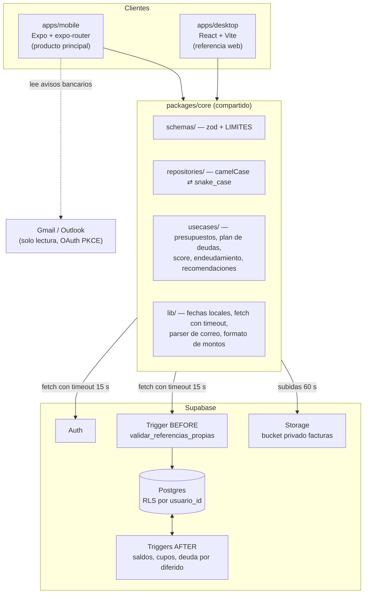

# gastos-app

App de finanzas personales para Ecuador (Banco Guayaquil, Pichincha, Produbanco y Diners Club). Registra gastos, ingresos, tarjetas de crédito, cuentas, deudas, recordatorios, categorías y presupuestos.

**El producto principal es la app de teléfono** (`apps/mobile`). La versión web (`apps/desktop`) hoy es la más completa y sirve de referencia para la migración. Las dos comparten la misma lógica (`packages/core`) y el mismo backend (Supabase).

> **Estado (15-oct-2026):** saldos confiables (con saldo a favor), montos con coma decimal, correo opcional que se olvida al cerrar sesión, y primer uso directo hacia el primer gasto, aplicados y verificados: **71/71 pruebas de lógica, 89/89 de base de datos** (incluye dos abonos simultáneos), tipos sin errores en core, web y teléfono, y la app de Android compila. El plan de 10 pasos y el informe del Paso 1 están en [`docs/plan-10-pasos-y-paso-1.docx`](docs/plan-10-pasos-y-paso-1.docx); el piloto, en [`docs/piloto.md`](docs/piloto.md). Qué migración está desplegada en cada entorno: ver [Estado de despliegue](#estado-de-despliegue).

## Contenido

1. [Arquitectura](#arquitectura)
2. [Stack](#stack)
3. [Estructura del repositorio](#estructura-del-repositorio)
4. [Primeros pasos](#primeros-pasos)
5. [Plan de 10 pasos](#plan-de-10-pasos)
6. [Organización del trabajo](#organización-del-trabajo)
7. [Funcionalidades](#funcionalidades)
8. [packages/core](#packagescore)
9. [Base de datos](#base-de-datos)
10. [Seguridad](#seguridad)
11. [Pruebas y verificación](#pruebas-y-verificación)
12. [Detección de movimientos por correo](#detección-de-movimientos-por-correo)
13. [Modelo de negocio](#modelo-de-negocio)
14. [Errores corregidos](#errores-corregidos)
15. [Pendientes y riesgos conocidos](#pendientes-y-riesgos-conocidos)
16. [Reglas para contribuir](#reglas-para-contribuir)
17. [App instalable y actualizaciones](#app-instalable-y-actualizaciones)

## Arquitectura



**Principios:**

- **El dinero se calcula en la base, nunca en el cliente.** Saldos, cupos y deudas derivadas se ajustan con triggers de Postgres, así el dato es correcto venga de la web o del teléfono.
- **`packages/core` es la única puerta a Supabase.** Valida con zod antes de ir a la red y traduce entre TypeScript y las tablas. Ninguna app duplica esa lógica.
- **La base es la última barrera de seguridad.** La clave pública de Supabase viaja dentro de la app, así que RLS, los CHECK y los triggers de validación protegen los datos aunque alguien llame a la API directamente.

## Stack

| Capa | Tecnología |
|---|---|
| Teléfono | Expo SDK 51, expo-router 3, React Native 0.74, expo-font, componentes propios |
| Web | React 18, Vite 5, CSS propio con variables (tema claro/oscuro). Tauri está declarado pero `src-tauri` no está inicializado |
| Lógica compartida | TypeScript, zod |
| Backend | Supabase: Postgres con RLS, Auth, Storage |
| OCR y lectura de PDF (web) | Tesseract.js, pdf.js |
| Correo (teléfono) | expo-auth-session (OAuth PKCE), expo-secure-store, Gmail API, Microsoft Graph |
| Pruebas | `node:test` (sin dependencias nuevas) y SQL sobre un Postgres desechable en Docker |

## Estructura del repositorio

```
apps/
  mobile/                 app de teléfono (Expo)
    app/(auth)/            login, registro, conectar correo
    app/(tabs)/            Resumen · Ingresos · Gastos · Tarjetas · Más
    app/                   cuentas, cuenta/[id], tarjeta/[id], deudas, recordatorios,
                           categorías, gasto/nuevo, ingreso/nuevo, correo, bandeja
    components/            componentes visuales (Dock, Motion, AnimatedList, Boton, Tarjeta…)
    lib/                   tema, cliente Supabase, OAuth y APIs de Gmail/Outlook
  desktop/                versión web (React + Vite)
    src/views/             Resumen, Ingresos, Gastos, Tarjetas, Cuentas, Deudas,
                           Recordatorios, Categorías
    src/components/        Dock, ThemeToggler, BlurFade, RippleButton, gráficos…
    src/lib/               cliente Supabase, OCR, estado de cuenta, catálogo de tarjetas
packages/
  core/
    src/                   tipos, schemas, repositorios, casos de uso, lib
    test/                  pruebas de lógica (node --test)
supabase/
  migrations/              13 migraciones en orden cronológico
  tests/                   pruebas de base de datos + script correr.sh
  seed.sql                 categorías globales
docs/                     plan, informes (.docx) y contratos entre agentes
```

## Primeros pasos

Requisitos: Node 22.18 o superior, pnpm, Docker y el CLI de Supabase.

```bash
pnpm install
pnpm supabase:start          # Supabase local (Docker)
```

Copia las variables de entorno y complétalas:

```bash
cp apps/mobile/.env.example apps/mobile/.env
cp apps/desktop/.env.example apps/desktop/.env
```

| Variable | App | Uso |
|---|---|---|
| `EXPO_PUBLIC_SUPABASE_URL` / `EXPO_PUBLIC_SUPABASE_ANON_KEY` | teléfono | Proyecto Supabase. **Debe llevar el prefijo `EXPO_PUBLIC_`**; con otro prefijo la app compila pero nunca conecta. |
| `VITE_SUPABASE_URL` / `VITE_SUPABASE_ANON_KEY` | web | Proyecto Supabase. |
| `VITE_DEV_EMAIL` / `VITE_DEV_PASSWORD` | web | Auto-login **solo en `pnpm dev:desktop`**. En el build de producción se eliminan (verificado). |
| `EXPO_PUBLIC_MS_CLIENT_ID` | teléfono | Opcional: conectar Outlook. |
| `EXPO_PUBLIC_GOOGLE_CLIENT_ID` | teléfono | Opcional: conectar Gmail (ver [correo](#detección-de-movimientos-por-correo)). |

**Aplica las migraciones** antes de usar la app:

```bash
supabase migration up        # base local
supabase db push             # proyecto remoto
```

**Proyecto de Supabase nuevo, sin la CLI:** [`supabase/base-completa.sql`](supabase/base-completa.sql) tiene la base entera en un solo archivo: las 19 migraciones en orden y las categorías globales. En Supabase, abre *SQL Editor → New query*, pega el archivo completo y pulsa *Run*. Debe terminar mostrando `migraciones_registradas = 19`.

- Es para un proyecto **vacío**. Corre en una sola transacción: si algo falla, no cambia nada.
- Marca las migraciones como aplicadas, así que después `supabase db push` solo aplicará las nuevas.
- No trae datos de ninguna persona.
- Al agregar una migración, regenéralo con `bash supabase/generar-base-completa.sh`.
- Verificado en una base desechable: queda idéntico a aplicar las migraciones una por una, y pasan las 88 pruebas de base de datos.

Ejecutar:

```bash
pnpm dev:mobile              # Expo (Expo Go, emulador o web)
pnpm dev:desktop             # versión web
```

## Plan de 10 pasos

Los pasos 1 a 5 construyen las ideas de producto y negocio; los pasos 6 a 10 llevan al teléfono todo lo que hoy tiene la web. Ningún paso se da por terminado sin pruebas que lo demuestren. Detalle completo (objetivos, tareas, criterios y seguridad de cada paso) en [`docs/plan-10-pasos-y-paso-1.docx`](docs/plan-10-pasos-y-paso-1.docx).

| # | Paso | Estado |
|---|---|---|
| 1 | Presupuestos inteligentes | ✅ Lógica, base y pantalla móvil · ⏳ validar con usuarios si se entiende |
| 2 | Plan de salida de deudas + score financiero | 🟡 Abono atómico con cuenta de origen (teléfono) · ⏳ pantallas de plan y score |
| 3 | Recordatorios y alertas reales (notificaciones locales, recurrentes) | ⏳ |
| 4 | Detección por correo bien hecha (remitentes, OAuth nativo, confirmación atómica) | ⏳ |
| 5 | Modelo de negocio y hoja de ruta | ⏳ |
| 6 | Resumen y navegación como en la web | 🟡 Interfaz en curso |
| 7 | Gastos e ingresos con paridad completa | ⏳ |
| 8 | Tarjetas y cuentas como en la web | ⏳ |
| 9 | Captura: OCR, factura y estado de cuenta | ⏳ |
| 10 | Deudas, recordatorios, categorías y cierre para tiendas | ⏳ |

## Organización del trabajo

El trabajo se reparte entre varios agentes que se coordinan con contratos escritos en `docs/`:

| Área | Responsable | Archivos |
|---|---|---|
| Lógica, base de datos y seguridad | Agente de lógica | `packages/core`, `supabase/`, `apps/*/lib` de red |
| Base visual y animaciones | Agente 2 | `apps/desktop/src/index.css`, `src/components`, `apps/mobile/lib/theme.ts`, `apps/mobile/components` |
| Pantallas | Agente 3 | `apps/desktop/src/App.tsx`, `src/views`, pantallas de `apps/mobile/app` |

| Documento | Contenido |
|---|---|
| [`docs/plan-10-pasos-y-paso-1.docx`](docs/plan-10-pasos-y-paso-1.docx) | Plan completo, informe del Paso 1 y auditoría de seguridad |
| [`docs/contrato-logica-core.md`](docs/contrato-logica-core.md) | Funciones de core disponibles para la interfaz, errores y límites |
| [`docs/contrato-ui-web.md`](docs/contrato-ui-web.md) · [`docs/contrato-ui-movil.md`](docs/contrato-ui-movil.md) | Componentes visuales de cada app |
| [`docs/plan-migracion-interfaz-movil.md`](docs/plan-migracion-interfaz-movil.md) | Plan de la migración visual web → teléfono |

**Rediseño visual en curso:** dock flotante tipo "isla" con las cinco rutas, tema claro/oscuro persistente (con opción "Sistema"), animaciones de entrada y botones con ripple que respetan "reducir movimiento", y fuentes locales (Fraunces, IBM Plex, licencia OFL).

## Funcionalidades

| Módulo | Web | Teléfono |
|---|---|---|
| Resumen | Balance del mes, gráfico de 7 días, salud financiera, recomendaciones, actividad | Igual, sin selector de mes (Paso 6) |
| Gastos | Alta completa, factura adjunta, OCR de recibos, importar estado de cuenta, pestañas por semana, edición en línea, diferido a 1-24 meses | Crear y eliminar (Pasos 7 y 9) |
| Ingresos | Alta, gráfico por semana o mes | Crear y eliminar (Paso 7) |
| Tarjetas | Catálogo de 74 productos con imagen real, cupo, estado de cuenta, pago con cuenta de origen | Degradado + logo del banco (Paso 8) |
| Cuentas | Logo del banco, ocultar saldo, acciones rápidas | Lista + detalle |
| Deudas | Manuales y automáticas (desde un diferido), abono | Paridad |
| Recordatorios | CRUD, recurrentes, completado | Paridad |
| Categorías | CRUD propio; globales de solo lectura; "Otros" con detalle | Paridad |
| Presupuestos | Lógica lista (Paso 1) | ✅ Pantalla con barras de uso |
| Correo | — | Gmail / Outlook → bandeja de revisión |

## packages/core

Única puerta de entrada a Supabase para las dos apps. Todo se importa desde `"core"`.

**Nuevo en el Paso 1 (y adelanto del Paso 2):**

| Función | Qué hace |
|---|---|
| `guardarPresupuesto({ categoriaId, montoLimite, mes })` | Crea o actualiza: uno por usuario, categoría y mes |
| `listarPresupuestos(mes?)` / `eliminarPresupuesto(id)` | Lectura y borrado |
| `estadoPresupuestos(mes, presupuestos, gastos, categorias)` | Gastado, restante y porcentaje; nivel `ok` / `cerca` (≥ 80 %) / `excedido` (≥ 100 %) |
| `sugerirLimite(categoriaId, mes, gastos)` | Promedio de los 3 meses previos con gasto, redondeado a múltiplos de 5 |
| `generarRecomendaciones({ …, presupuestos })` | Agrega avisos de presupuesto (parámetro opcional) |
| `planDeudas(deudas, pagoMensual, "bola_de_nieve" \| "avalancha")` | Orden de liquidación, meses e interés total; `viable: false` si el pago no alcanza |
| `scoreFinanciero(…)` | 0-100: endeudamiento 35 + ahorro 30 + uso de cupo 20 + recordatorios 15 |
| `calcularEndeudamiento(deudas, ingresoMes, ingresoReferencia?)` | El tercer parámetro evita marcar "bajo" en un mes sin ingresos |
| `fechaLocal()` / `mesLocal()` | "Hoy" y "mes actual" en la zona horaria del teléfono (no UTC) |
| `crearFetchConTimeout(opciones)` / `ErrorTiempoAgotado` | `fetch` que corta a los N segundos con un mensaje claro |
| `LIMITES` | Longitudes y montos máximos, iguales a los de la base |
| `registrarAbonoDeuda(id, monto, { cuentaId?, fecha? })` | Abono **atómico** en la base: baja el saldo, descuenta de la cuenta de origen, libera cupo si es un diferido en tarjeta y mueve el próximo pago. Si el monto supera el saldo, cobra solo lo pendiente |
| `listarAbonosDeuda(deudaId?)` | Historial de abonos (solo lectura) |
| `actualizarIngreso(id, cambios)` | Edita un ingreso validado con zod; la base reajusta el saldo si cambian monto o cuenta |
| `mensajeError(err)` | Además traduce los fallos de red a "No se pudo conectar con el servidor…" |

**Lo que ya existía:** tipos de dominio, un schema zod por entidad, repositorios (`listar*`, `eliminar*`, mapeo de nombres), casos de uso `crear*`, `balanceGeneral`, y utilidades: semanas fijas del mes, línea de tiempo de una cuenta, colores por banco, agrupación por categoría, formato de montos (`-$50.00`), extracción de mensajes de error de Supabase, normalización de números latinos y el parser de correos bancarios.

## Base de datos

### Triggers

| Trigger | Momento | Qué hace |
|---|---|---|
| `validar_referencias_propias` | BEFORE INSERT/UPDATE en 7 tablas | **Nuevo.** Rechaza cuentas, categorías, deudas o gastos de otro usuario |
| `aplicar_gasto_a_cuenta` | AFTER INSERT gastos | Resta el monto del disponible |
| `revertir_gasto_de_cuenta` | AFTER DELETE gastos | Devuelve el monto sin pasar del cupo |
| `ajustar_gasto_actualizado` | AFTER UPDATE gastos | Revierte lo viejo y aplica lo nuevo |
| `aplicar_ingreso_a_cuenta` / `revertir_ingreso_de_cuenta` | ingresos | Suma o resta (no en tarjetas de crédito) |
| `aplicar_pago_tarjeta` | AFTER INSERT pagos_tarjeta | Sube el cupo y descuenta de la cuenta de origen |
| `crear_deuda_de_gasto_diferido` | AFTER INSERT gastos | Crea la deuda tipo `diferido` con su cuota mensual |
| `ajustar_ingreso_actualizado` | AFTER UPDATE ingresos | **Nuevo.** Editar un ingreso revierte el monto/cuenta viejos y aplica los nuevos |
| `proteger_gasto_diferido` | BEFORE UPDATE gastos | **Nuevo.** Un diferido no se edita en monto, cuenta, método ni plazo (se elimina y se registra de nuevo); un gasto no se vuelve diferido al editarlo |

Los de saldo son `security definer`, fijan `search_path` y filtran por `usuario_id`. Además:

- **`registrar_abono_deuda(...)`** (función, no trigger): abono atómico con la deuda y la cuenta bloqueadas (`for update`); deja constancia en `abonos_deuda`, un historial que la app solo puede leer. Solo la pueden ejecutar usuarios con sesión.
- **Los pagos de tarjeta no se borran desde la app:** son movimientos de dinero reales. Borrarlos sin revertir dejaba saldos inflados, y revertirlos solos sería incorrecto cuando desaparecen por borrar la tarjeta. Si se necesita anular uno, será con una función explícita.

### RLS

Todas las tablas tienen Row Level Security con `auth.uid() = usuario_id`. Única excepción a propósito: las categorías con `usuario_id` nulo son globales y de solo lectura.

### Migraciones

| Archivo | Qué agrega |
|---|---|
| `20260826120000_gastos` | `categorias`, `gastos`, `presupuestos` |
| `20260826130000_rls_policies` | `usuario_id` y políticas RLS |
| `20260826140000_finanzas_completas` | `cuentas`, `ingresos`, `pagos_tarjeta`, `deudas`, `recordatorios` y triggers de saldo |
| `20260830120000_estilo_tarjeta` | `cuentas.estilo` |
| `20260830130000_eliminar_cuenta_con_movimientos` | Claves foráneas con SET NULL / CASCADE |
| `20260830140000_categorias_crud` | Categorías propias por tipo, "Otros" con detalle |
| `20260830150000_gastos_factura_metodo_pago` | Método de pago, factura, bucket `facturas`, trigger de edición |
| `20260831120000_banco_diners_club` | Diners Club como banco |
| `20260831130000_gasto_diferido` | Meses de diferido y deuda automática |
| `20260831140000_fix_metodo_pago_diferido` | Corrige el CHECK de `metodo_pago` |
| `20260831150000_pago_tarjeta_origen_y_tipo_diferido` | Cuenta de origen en pagos; tipo de deuda `diferido` |
| `20260901120000_correo_transacciones_detectadas` | `cuentas.identificador` y cola de revisión del correo |
| `20261013120000_seguridad_y_presupuestos` | Validación de referencias propias, `search_path` fijo, límites de texto, presupuestos únicos, bucket limitado, timeouts por rol e índices |
| `20261014120000_abono_deuda_atomico` | Tabla `abonos_deuda` y función `registrar_abono_deuda` |
| `20261014130000_saldos_confiables` | Edición de ingresos con reajuste, pagos de tarjeta sin borrado, cuenta de origen con SET NULL, diferidos protegidos |
| `20261014140000_correo_confirmacion_y_privacidad` | Confirmación atómica e idempotente de la bandeja; el asunto se borra al resolver el aviso |
| `20261014150000_agregar_bancos_pacifico_y_austro` | Banco del Pacífico y Banco del Austro como bancos |
| `20261015120000_integridad_saldos` | Saldo a favor en tarjetas, edición de gastos pagados por diferencia, diferidos solo en tarjeta y con plazo, deudas protegidas al borrar, avisos resueltos inmutables, categorías borradas pasan a "Otros", abono con mínimo de $0,01 |
| `20261015150000_categoria_salud` | Categoría global "Salud" |

### Estado de despliegue

Actualizar esta tabla cada vez que se aplique una migración en un entorno.

| Entorno | Migraciones aplicadas | Última | Fecha |
|---|---|---|---|
| Supabase local (Docker, `127.0.0.1:54321`) | 18 de 19 (falta `20261015150000_categoria_salud`) | `20261015120000_integridad_saldos` | 15-oct-2026 |
| Supabase remoto | — | — | El proyecto anterior (`yzuwuvjywxiujtvxpdkx`) ya no existe; falta crear uno nuevo |

Para comprobarlo en cualquier base: `select version, name from supabase_migrations.schema_migrations order by version;`

## Seguridad

### Hallazgo corregido: falla de autorización en los triggers de saldo

RLS solo revisa la fila que se inserta, no las filas a las que apunta. Un usuario podía crear un gasto con el `cuenta_id` de **otra persona** y el trigger privilegiado le descontaba el saldo a esa cuenta ajena. Lo mismo pasaba con ingresos y con pagos de tarjeta usando una cuenta ajena como origen.

- **Evidencia** (base con las migraciones anteriores): el usuario A bajó el saldo de B de 1000 a 300 y pagó su propia tarjeta con 400 de B.
- **Atenuante:** hace falta conocer el UUID de la cuenta de la víctima, que la API no le muestra a otros usuarios.
- **Corrección:** trigger `validar_referencias_propias` en las 7 tablas con referencias, y triggers de saldo que filtran por dueño. Ahora los 12 ataques de prueba fallan con "La cuenta indicada no existe o no es tuya." y el saldo de B queda intacto.

### Inyección SQL

No hay superficie de inyección SQL:

- La app no escribe SQL. El cliente de Supabase envía los valores a PostgREST como parámetros, nunca como código.
- No se usan `.or()`, `.filter()` con texto ni `rpc` con SQL armado (revisado en todo el repositorio).
- Los triggers usan SQL estático, sin `EXECUTE` con texto concatenado.
- Prueba S10: la descripción `'); drop table gastos; --` se guarda como texto y la tabla sigue existiendo.

### Timeouts

| Capa | Límite |
|---|---|
| Peticiones a Supabase (datos y login) | 15 s |
| Subida de facturas | 60 s |
| Gmail y Microsoft Graph | 20 s |
| Consultas de usuarios autenticados en Postgres | 8 s (`statement_timeout`) |
| Consultas anónimas | 3 s |

Al agotarse, el usuario ve "La conexión tardó más de 15 s. Revisa tu internet e inténtalo de nuevo." Hay índices por usuario y fecha para que las consultas normales no se acerquen al límite.

### Validación de datos

Doble barrera: zod en `core` (mensaje claro antes de ir a la red) y CHECK en la base (si alguien llama a la API directo).

| Campo | Regla |
|---|---|
| Descripción | 1-200 caracteres, no solo espacios |
| Nombre (cuenta, deuda, categoría) | 1-80 caracteres |
| Título de recordatorio | 1-120 caracteres |
| Montos | > 0 y ≤ 9 999 999 999,99; sin NaN ni infinito |
| Fechas / meses | `YYYY-MM-DD` / `YYYY-MM` válidos |
| Identificador de cuenta | 3 o 4 dígitos |
| Color | `#RRGGBB` |
| Factura | Dentro de la carpeta del propio usuario |
| Pago de tarjeta | El origen no puede ser la misma tarjeta |

Los textos que vienen de correos de terceros se recortan antes de guardarse.

### Otras medidas

- **Funciones privilegiadas:** todas las funciones `security definer` (10) fijan `search_path = public, pg_temp`; una prueba lo verifica en cada corrida.
- **Facturas:** bucket privado, URLs firmadas de 1 hora, máximo 10 MB, solo PDF/JPEG/PNG/WEBP/HEIC y sin permiso para reemplazar archivos.
- **Credenciales:** las variables `VITE_DEV_*` solo se leen en desarrollo. Un build de producción con una contraseña centinela la contiene 0 veces. La anon key es pública por diseño (la protección es RLS) y la `service_role` nunca debe estar en una app.
- **Tokens de correo:** solo en `expo-secure-store` del teléfono, nunca en la base.

## Pruebas y verificación

```bash
pnpm --filter core test          # 71 pruebas de lógica
bash supabase/tests/correr.sh    # 89 pruebas de base de datos (requiere Docker)
```

- **Lógica:** cálculos comparados contra resultados hechos a mano: presupuestos, plan de deudas, score, timeouts, fechas locales, mensajes de error y validación.
- **Base de datos:** el script levanta un Postgres desechable con la misma imagen de Supabase, aplica todas las migraciones desde cero, simula dos usuarios con su JWT (igual que PostgREST) y borra el contenedor al terminar. **Nunca toca tu base local ni la de producción.** Archivos:
  - `seguridad_y_presupuestos.sql` (36): ataques entre usuarios, flujo de saldos, presupuestos, límites y configuración.
  - `abono_deuda.sql` (13): abono atómico, recorte al saldo, cuenta de origen, cupo del diferido, permisos.
  - `saldos_confiables.sql` (13): edición de ingresos, pagos de tarjeta, borrado de cuentas y diferidos.
  - `correo_bandeja.sql` (10): confirmación atómica e idempotente, aislamiento entre usuarios y borrado de los datos del correo.
  - `integridad_saldos.sql` (16): saldo a favor, edición de gastos pagados, diferidos, borrado de deudas y categorías, avisos resueltos y borrado de un usuario con abonos.
  - Concurrencia (1): dos abonos simultáneos de 70 sobre una deuda de 100 dejan la cuenta en −100, no en −140.
- **Compilación:**

```bash
cd apps/desktop && npx tsc --noEmit
npx tsc --noEmit -p ../../packages/core
cd ../mobile && npx tsc --noEmit
```

Aún sin verificar: el timeout en un teléfono físico y el upsert de presupuestos desde la app contra el servidor (se probó el SQL equivalente).

## Detección de movimientos por correo

**Función opcional y en beta.** Ya no es un paso del registro: vive en *Más → Correo (beta)* y la app se usa completa sin conectarlo. Solo en el teléfono. Conectas Gmail u Outlook y la app detecta avisos bancarios. **Nada se guarda solo:** todo cae en la bandeja de revisión (`transacciones_detectadas`) para confirmar o descartar.

- OAuth con PKCE y sin secreto en la app (`lib/gmailAuth.ts`, `lib/outlookAuth.ts`); tokens en `expo-secure-store`.
- El parser (`parsearCorreoBancario` en core) saca tipo, monto, fecha y últimos dígitos de la cuenta. El remitente se reconoce por **dirección exacta o dominio exacto** (antes bastaba con que lo "contuviera").
- Sin duplicados: `unique (usuario_id, mensaje_id)`, y **confirmar es atómico** (`confirmar_transaccion_detectada`): reintentar nunca duplica el gasto.
- **Qué se guarda:** monto, fecha, banco y asunto de cada aviso reconocido; el texto del correo se analiza en el teléfono. El asunto se borra al confirmar o descartar.
- **Desconectar** revoca el permiso ante Google (en Outlook se le indica a la persona dónde quitarlo, porque Microsoft no permite revocarlo desde una app pública), borra los tokens del teléfono y borra todos los avisos guardados. Los gastos ya confirmados se quedan.

**Configuración:**

- **Outlook:** Azure → App registrations → plataforma "Mobile and desktop applications" con redirect `gastosapp://redirect`.
- **Gmail:** Google Cloud → habilitar Gmail API → OAuth client ID. **Por confirmar en el Paso 4:** el cliente de tipo "Web application" exige un secreto y no acepta redirects `gastosapp://`; lo habitual en móvil es un cliente Android/iOS. Además, `gmail.readonly` es un permiso restringido: para publicar hace falta la verificación de Google, y en modo de prueba el token caduca a los 7 días.

**Limitaciones actuales (Paso 4):** la lista de remitentes de bancos (`REMITENTES_BANCO`) está vacía hasta tener muestras reales, así que el banco queda sin asignar en la bandeja; no se verifica DKIM/SPF (un remitente falsificado con el dominio real pasaría, por eso todo va a revisión humana); no hay sincronización en segundo plano. Cada búsqueda pagina hasta 500 correos y avisa si hubo más.

**Privacidad al cerrar sesión (15-oct):** el permiso de correo es del teléfono, no de la cuenta. Al cerrar sesión se borran los tokens (y se revoca el de Google), y la conexión queda ligada a quien la hizo: si entra otra persona en el mismo teléfono, se olvida. Si el permiso fue retirado (`invalid_grant`), la app borra los tokens y pide reconectar. La revocación ante Google no se ha probado con un Client ID real.

## Modelo de negocio

Propuesta del Paso 5, como hipótesis a validar con usuarios:

- **Freemium.** Gratis: cuentas, gastos, ingresos y 1 presupuesto. Premium: detección por correo, presupuestos ilimitados, plan de deudas, score, exportación y varios dispositivos.
- **Otras vías:** alianzas con bancos y cooperativas (comparador de tarjetas con el catálogo de 74 productos), reportes premium, modo pareja/familia.
- **Hoja de ruta:** MVP (pasos 6-10) → beta cerrada → tiendas → monetización.
- **Métricas:** retención a 30 días, gastos registrados por semana, conversión a Premium.
- **Cumplimiento:** Ley Orgánica de Protección de Datos Personales de Ecuador (consentimiento, política de privacidad, borrar la cuenta, que también exige Google Play). Los datos financieros nunca se venden.

## Errores corregidos

**En esta etapa (Paso 1 y auditoría):**

- Un usuario podía mover el saldo de cuentas ajenas (ver [Seguridad](#seguridad)).
- "Hoy" y "mes actual" se calculaban en UTC: en Ecuador, a las 21:30 del 13 la app decía que era el 14. Corregido en core con `fechaLocal()`; faltan unas 26 pantallas.
- `sumarMeses` también pasaba por UTC.
- La contraseña de desarrollo de la web se incrustaba en el JavaScript publicado.
- Presupuestos sin restricción única; borrar una categoría con presupuesto fallaba; "Borrar todo" omitía dos tablas.
- `planDeudas` sin deudas devolvía "no viable" (error del código nuevo, encontrado por las pruebas).
- Saldos (14-oct): el abono desde el teléfono no descontaba de ninguna cuenta; editar un ingreso descuadraba la cuenta; borrar un pago de tarjeta dejaba el cupo inflado; no se podía borrar una cuenta usada para pagar una tarjeta; editar un diferido dejaba la deuda desactualizada.
- App de teléfono (14-oct): se caía en Expo Go por `expo-linking`/`expo-constants` de otra versión de Expo y por dos copias de `expo-router`; la raíz `/` no tenía pantalla.
- Integridad (15-oct, revisión con dos agentes de búsqueda de errores): un monto con coma ("12,50") se guardaba como NaN; pagar de más una tarjeta perdía el dinero; editar un gasto ya pagado perdía cupo; un diferido en cuenta de ahorro cobraba dos veces; borrar un diferido con abonos inflaba el cupo; 100,30 − 50,10 − 50,20 mostraba "−$0.00"; el detalle de una cuenta no mostraba los pagos ni los abonos que salían de ella; los errores de validación salían como JSON en inglés; quien iniciaba sesión después en el mismo teléfono seguía leyendo el correo de la persona anterior; la búsqueda de correo leía solo 40 y saltaba los que llegaban mientras buscaba; un recordatorio mensual se quedaba tachado para siempre.
- Activación y correo (14-oct): conectar el correo era un paso obligado del registro; desconectar no revocaba el permiso ni borraba los datos; confirmar en la bandeja podía duplicar el gasto; el remitente se aceptaba si solo "contenía" el dominio del banco; "Salud financiera" decía "tus ingresos cubren tus gastos" sin ningún ingreso registrado; quedaban fechas en UTC en el teléfono.

**Antes:** el CHECK de `metodo_pago` no aceptaba `diferido`; errores mostrados como `[object Object]`; montos como `$-921.70`; pagar una tarjeta no descontaba de ninguna cuenta; deudas por diferido indistinguibles de préstamos; `.env` móvil con prefijo `VITE_`; `metro.config.js` rompía la resolución en el monorepo; ruta raíz sin pantalla; `expo-secure-store` dejaba en blanco "Correo" en web; la bandeja escondía errores de red.

## Pendientes y riesgos conocidos

| Pendiente | Gravedad | Paso |
|---|---|---|
| Crear un Supabase remoto y aplicarle `supabase/base-completa.sql` (las 19 migraciones; la local tiene 18, falta `20261015150000_categoria_salud`) | Alta | Piloto |
| Ajustes de interfaz pedidos por la revisión del 15-oct: saldo a favor visible, solo tarjetas en diferidos, confirmar al borrar categorías, semana actual en Gastos y otros (lista en `docs/contrato-logica-core.md`) | Media | 6-10 |
| Abono con cuenta de origen en la **web** (el teléfono ya lo tiene) | Media | Fase web |
| Pantalla para editar ingresos (base y `actualizarIngreso` listos) | Media | 7 |
| Anular un pago de tarjeta por error (hoy no se puede borrar, a propósito) | Baja | 3 |
| Borrar una deuda con recordatorios falla por la clave foránea (el teléfono ahora muestra el error) | Media | 3 |
| Correo: remitentes reales vacíos, tipo de cliente OAuth de Google, verificación de Google para `gmail.readonly` (no promocionarlo hasta resolverlo) | Media | 4 |
| El nivel de endeudamiento sale 0 % en un mes sin ingresos (core ya acepta un ingreso de referencia; falta usarlo en las pantallas) | Baja | 6 |
| La web no tiene login ni cierre de sesión; botón "Borrar todo (temporal)" visible | Alta antes de publicar la web | Fase web |
| Reemplazar `toISOString().slice(…)` por `fechaLocal()` en las pantallas de la **web** (el teléfono ya está; quedan 9 usos en 8 archivos) | Media | Fase web |
| Políticas RLS con `(select auth.uid())` para rendimiento; límites de intentos de login en Supabase | Baja / Media | 10 |
| Ícono y pantalla de inicio propios (identificador y actualizaciones ya configurados) | — | 10 |

## Reglas para contribuir

1. **Nada de SQL armado con texto.** Ni `.or()`/`.filter()` con lo que escribe el usuario, ni `EXECUTE` concatenado. Si hace falta SQL dinámico: `format()` con `%L` / `%I`.
2. **Toda entrada pasa por un schema de core**, y toda regla importante se repite como CHECK en la base.
3. **Saldos y cupos solo con triggers.** Ninguna pantalla calcula dinero que se guarde.
4. **Fechas con `fechaLocal()` / `mesLocal()`**, nunca `toISOString()` para "hoy".
5. **Errores con `mensajeError(err)`** y campos con `maxLength` según `LIMITES`.
6. **Nada se da por terminado sin pruebas:** `pnpm --filter core test` y `bash supabase/tests/correr.sh` en verde.
7. **Secretos fuera del repositorio:** los `.env` están en `.gitignore`; nunca usar `service_role` en una app.

## App instalable y actualizaciones

La app de teléfono se instala una vez (**EAS Build**) y recibe los cambios sola (**EAS Update**). Ya están configurados `app.json` (identificador `com.csebastia.gastosapp`, `runtimeVersion`, búsqueda de actualizaciones al abrir), `eas.json` (APK de prueba y AAB para Google Play) y `expo-updates`. Desde `apps/mobile`:

```bash
pnpm build:apk            # compila el APK instalable
pnpm update:prueba        # publica un cambio al canal de prueba
pnpm update:produccion    # publica a los usuarios
```

Cada comando pasa primero por `scripts/verificar-entorno-publicacion.mjs`, que **frena la publicación** si la URL de Supabase es local o la clave es la `service_role`. Configuración inicial, reglas (primero la base, migraciones compatibles hacia atrás, cambio nativo = nueva versión) y cómo volver atrás: [`docs/actualizaciones.md`](docs/actualizaciones.md).
