# FinTrack

**Tus finanzas personales, claras y en un solo lugar.** FinTrack es una app para el teléfono, pensada para Ecuador y Latinoamérica. Junta tus gastos, ingresos, tarjetas, cuentas, deudas y presupuestos. Además, anota sola los pagos que haces con Google Wallet.

  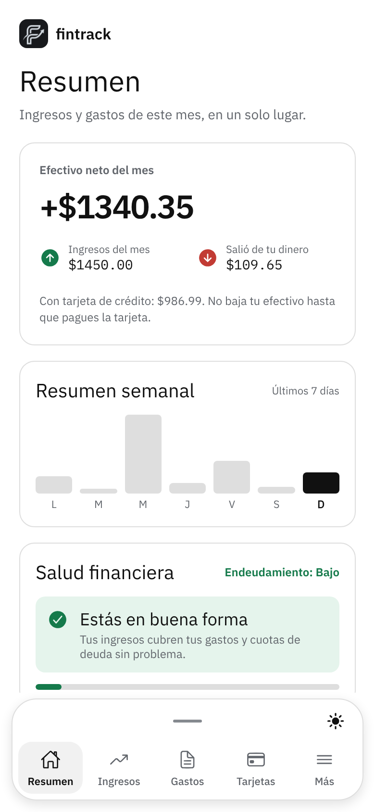
  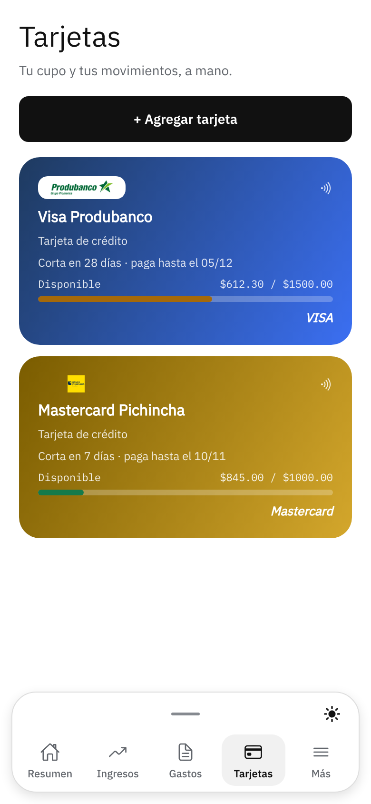
  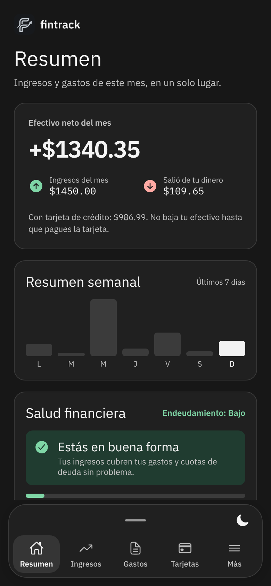

> Este repositorio es una **vitrina** del proyecto. El código fuente es privado.
>
> **Estado:** en desarrollo. Versión 1.4.0 para Android.

## Contenido

- [Qué es](#qué-es)
- [Funciones](#funciones)
- [Así se usa](#así-se-usa)
- [Capturas de pantalla](#capturas-de-pantalla)
- [Tecnología usada](#tecnología-usada)
- [Privacidad](#privacidad)

## Qué es

Mucha gente paga con tarjeta, pasa dinero entre sus cuentas y compra a cuotas, pero no sabe cuánto le queda a fin de mes. FinTrack busca resolver eso con tres ideas:

1. **Fácil de usar.** Anotar un gasto toma segundos, y cada pantalla responde una sola pregunta: cuánto gasté, cuánto me queda o qué tengo que pagar.
2. **Automática.** Los pagos con Google Wallet se registran solos. Las transferencias entre tus cuentas se juntan solas y las cuotas de una compra diferida se agendan solas.
3. **Clara.** Gráficos simples, avisos a tiempo y una medida de tu salud financiera que se entiende de un vistazo.

Está hecha para el día a día en Ecuador: precios en dólares, bancos y casas comerciales del país, y compras diferidas de 3 a 24 meses.

## Funciones

| | Qué puedes hacer |
|---|---|
| **Resumen** | Efectivo neto del mes (lo comprado con tarjeta se descuenta al pagar la tarjeta), gastos de los últimos 7 días, salud financiera, recomendaciones y dónde gastas más |
| **Gastos e ingresos** | Anotarlos, editarlos y verlos por semana y por categoría. Compras diferidas con interés |
| **Tarjetas de crédito** | Cupo disponible, fecha de corte y de pago, consumos del ciclo y pago de la tarjeta desde una de tus cuentas |
| **Cuentas** | Ahorro, débito y efectivo, con su historial completo |
| **Transferencias** | Pasar dinero entre tus cuentas sin que cuente como gasto ni ingreso. Las que llegan por correo se juntan solas |
| **Google Wallet** | Pagas con el teléfono y el gasto se anota solo, en la tarjeta correcta, con su categoría y su lugar. Puedes apagarlo cuando quieras |
| **Bandeja de revisión** | Lo que la app detecta y no puede asignar con seguridad espera aquí: lo confirmas, lo corriges o lo descartas |
| **Presupuestos** | Un límite por categoría y por mes, con avisos al 75 %, al 100 % y al pasarte |
| **Recordatorios** | Pagos que se repiten y cuotas de tus compras diferidas, con aviso antes del vencimiento |
| **Deudas** | Préstamos y compras a cuotas, con sus abonos |
| **Lugares** | Cuánto gastas en cada local y en cada comercio, con mapa |
| **Estados de cuenta** | Importar el PDF o CSV del banco. Se lee en el propio teléfono y marca los duplicados |
| **Notificaciones** | Pago registrado, pagos por confirmar, recordatorios y presupuestos. Tú eliges cuáles recibir |
| **Modo oscuro** | Claro, oscuro o según el teléfono |

Reconoce bancos de Ecuador como Pichincha, Guayaquil, Produbanco, Pacífico, Austro y Diners Club, y casas comerciales como Comandato, Artefacta, Marcimex, La Ganga, Japón y De Prati.

## Así se usa

**Pagar con Google Wallet.** Pagas $12,50 en el supermercado con tu Visa terminada en 4321.

1. Google Wallet muestra su aviso del pago.
2. FinTrack reconoce la tarjeta por sus últimos dígitos y anota el gasto en «Comida», con la hora del pago y, si ya conoce el comercio, su lugar.
3. El cupo disponible de la tarjeta baja $12,50.
4. Te llega la notificación «Registré $12.50 en SUPERMAXI». Si algo no está bien, la tocas y lo corriges.

**Pasar dinero de ahorros a efectivo.** Pasas $40 de «Ahorro» a «Efectivo»: un saldo baja y el otro sube. Tu balance del mes no cambia, porque no gastaste nada.

**Cuidar un presupuesto.** Pones $200 para comida en octubre. Al llegar a $150 te avisa que vas por el 75 %, y si te pasas de $200 también te avisa. Cada aviso llega una sola vez.

**Comprar a cuotas.** Unos audífonos de $360 diferidos a 3 meses. La app descuenta el cupo de la tarjeta, anota la deuda y crea un recordatorio para cada cuota.

## Capturas de pantalla

Todas las capturas usan **datos de ejemplo**.

<table>
  <tr>
    <td align="center"> Resumen del mes</td>
    <td align="center">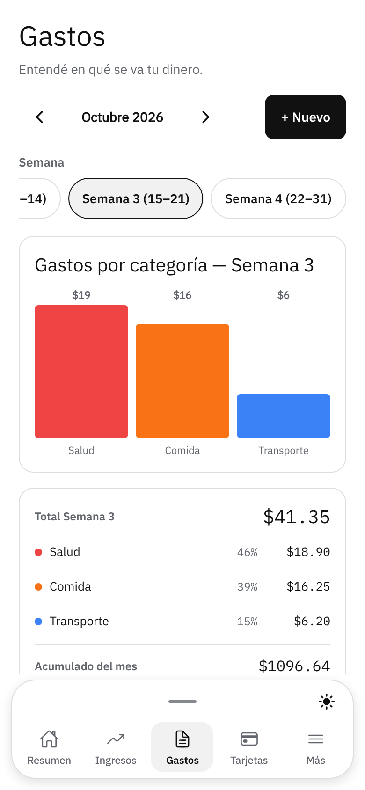 Gastos por semana y categoría</td>
    <td align="center"> Tarjetas y su cupo</td>
  </tr>
  <tr>
    <td align="center">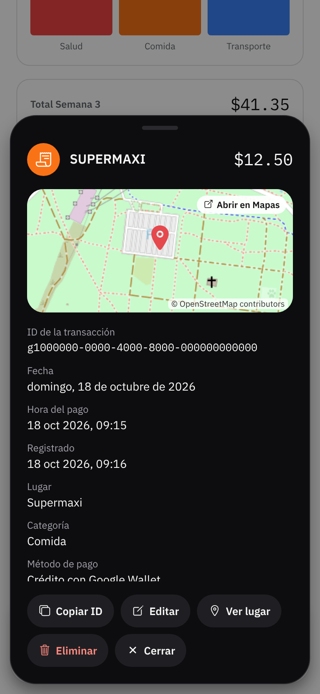 Pago con Google Wallet, con mapa</td>
    <td align="center">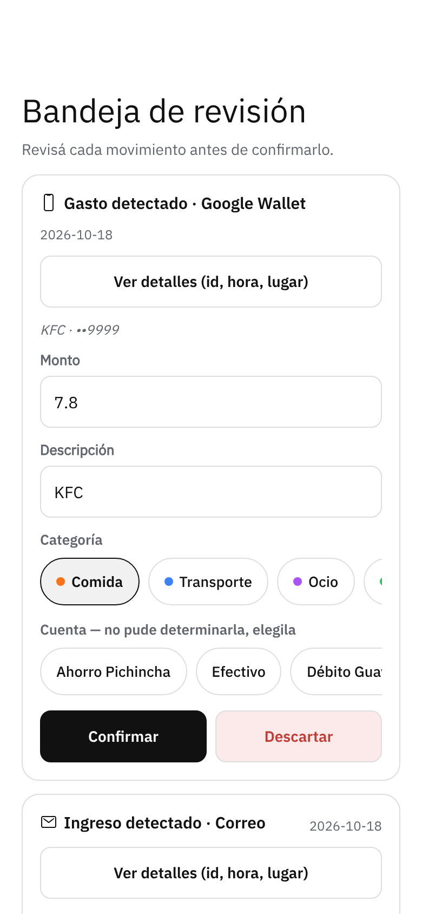 Bandeja de revisión</td>
    <td align="center">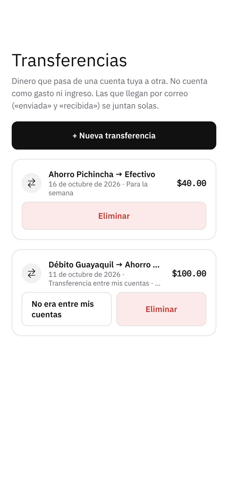 Transferencias entre tus cuentas</td>
  </tr>
  <tr>
    <td align="center">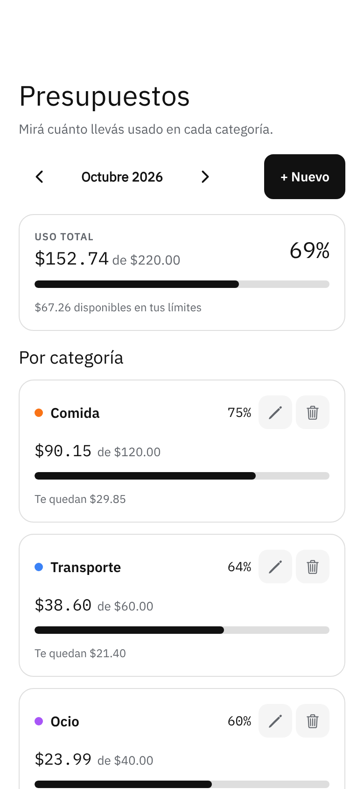 Presupuestos</td>
    <td align="center">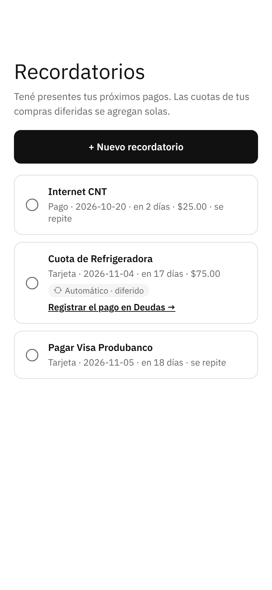 Recordatorios y cuotas</td>
    <td align="center">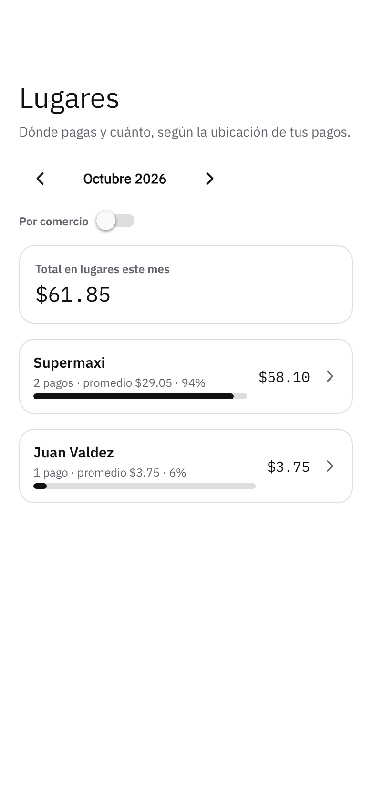 Dónde gastas</td>
  </tr>
  <tr>
    <td align="center">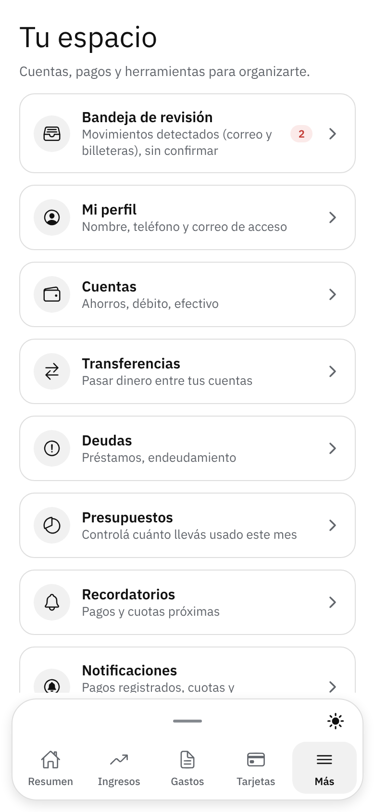 Todas las secciones</td>
    <td align="center"> Modo oscuro</td>
    <td align="center">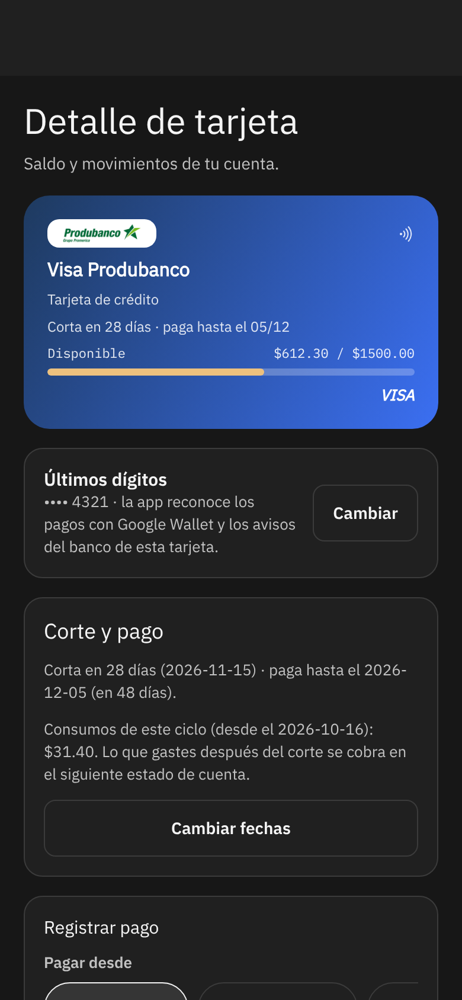 Detalle de tarjeta</td>
  </tr>
</table>

## Tecnología usada

| Parte | Tecnología |
|---|---|
| App de teléfono | [Expo](https://expo.dev) y [React Native](https://reactnative.dev), con expo-router para la navegación |
| Lenguaje | [TypeScript](https://www.typescriptlang.org) en toda la app, con [zod](https://zod.dev) para validar los datos |
| Integración con Android | Módulo nativo propio en [Kotlin](https://kotlinlang.org) para Google Wallet y las notificaciones |
| Backend | [Supabase](https://supabase.com): base de datos [PostgreSQL](https://www.postgresql.org), inicio de sesión y almacenamiento de archivos |
| Ubicación y mapas | expo-location y mapas de [OpenStreetMap](https://www.openstreetmap.org) |
| Notificaciones | expo-notifications, armadas en el propio teléfono |
| Estados de cuenta | [pdf.js](https://mozilla.github.io/pdf.js/), dentro de la app |
| Web de escritorio | [React](https://react.dev) y [Vite](https://vite.dev) |
| Organización | Monorepo con [pnpm](https://pnpm.io): la app, la web y una lógica compartida |
| Calidad | Más de 560 pruebas automáticas, entre la base de datos, la lógica y las pantallas |
| Publicación | Compilación de Android con EAS |

## Privacidad

- **Tus datos son tuyos.** Cada persona ve solo su propia información.
- **La ubicación es opcional.** Solo se guarda si la activas, y nunca en segundo plano.
- **Google Wallet, con tu permiso.** La app lee únicamente los avisos de Google Wallet, no los de otras apps, y puedes desconectarla cuando quieras.
- **Copia o borrado.** Puedes pedir una copia de tus datos, o borrar tu cuenta con todos tus datos, cuando quieras.

FinTrack no es una app oficial de Google ni de ningún banco. Los nombres y logos de bancos y marcas pertenecen a sus dueños.

---

© 2026 [CSEBASTIA](https://github.com/CSEBASTIA). Todos los derechos reservados.
